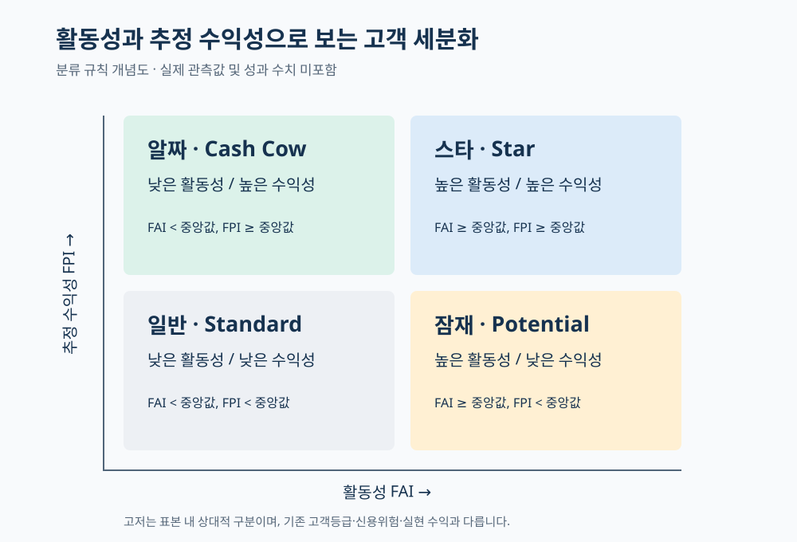
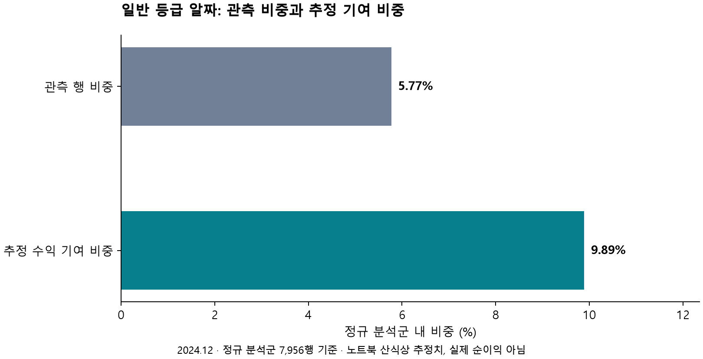
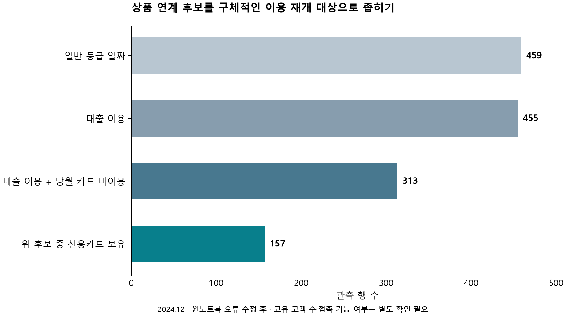
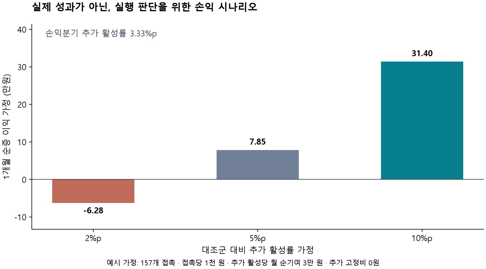

# IMBK8_Profitability_Analysis_Statistics

### 🏦 iM뱅크 법인 고객의 수익 세분화 및 알짜 고객 발굴

> **기업 고객의 거래 규모·빈도·상품 이용을 활동성(FAI)과 추정 수익성(FPI)으로 정리하고, 통계 분석을 통해 기존 고객등급을 보완하는 관리 대상을 탐색했습니다. 후속 분석에서는 고객군의 경제적 기여와 상품 연계 후보를 구체화하고, 실행에 필요한 손익분기 조건까지 검토했습니다.**

## 1. 프로젝트 개요

### 배경과 해결하려던 문제

같은 고객등급 안에서도 거래 규모, 이용 채널, 상품 구성, 은행에 대한 수익 기여는 다를 수 있습니다. 따라서 기존 등급과 함께 **“얼마나 거래하는가”와 “어떤 수익 기여를 보이는가”**를 보면 고객관리 우선순위를 더 구체적으로 정할 수 있다고 보았습니다.

이 프로젝트는 기존 등급을 대체하는 신용평가 모델이 아니라, 거래 데이터를 활용해 상담·관리 전략을 보완하는 분석입니다. 자료에 있는 `법인_고객등급`의 실제 산정식은 확인되지 않아 이를 신용등급이나 재무적 안정성 점수로 단정하지 않았습니다.

| 항목 | 내용 |
|---|---|
| 원 프로젝트명 | 중소기업 수익 세분화 및 고효율 ‘알짜’ 고객 발굴 |
| 프로젝트 기간 | 2026.03.16–03.27 |
| 팀 규모 | 5인 |
| 수행 역할 | PM 및 프로젝트 총괄 기획, 핵심 문제 정의, 데이터 전처리·정합성 검증, 가설 설정 및 통계 검정, FAI·FPI 지수 설계 |
| 분석 대상 | iM뱅크 교육용 법인 거래 데이터, 2022.01–2024.12 |
| 후속 보완 | 2026.08.10, 분석 재검증 및 고객관리·경제성 분석 |


### 분석 흐름과 핵심 결과

**문제 정의 → 데이터 정합성·분포 확인 → FAI/FPI 설계 → 사분면 세분화 → 가설 검정·사후검정 → 고객군 프로파일링 → 실행 후보 선정 → 경제성 검토**

| 질문 | 핵심 결과 | 활용 방향 |
|---|---|---|
| 기존 일반 등급에도 추가로 검토할 집단이 있는가? | 전체 기간 일반 등급 알짜 10,328행, 최신 월 459행 | 등급과 거래 특성을 함께 보는 관리 후보 |
| 이 집단의 기여 규모는 어느 정도인가? | 최신 월 정규 분석군의 5.77%, 추정 기여의 9.89%, 추정 기여 합계 약 18.92억 원 | 기존 거래의 상대적 기여를 파악. 실제 순이익·추가 이익과 구분 |
| 어떤 행동으로 연결할 것인가? | 대출 이용·당월 카드 미이용 313행 중 신용카드 보유 157행 | 기존 카드 이용 재개를 위한 상담·지원 후보 |
| 어느 조건에서 실행할 가치가 있는가? | 예시 비용·순기여 가정에서 손익분기 추가 활성률 3.33%p | 실제 원가와 대조군 실험으로 실행 여부 판단 |

## 2. 데이터 이해와 전처리

### 데이터 구성

| 구분 | 내용 | 분석에서의 용도 |
|---|---|---|
| 기간·규모 | 2022.01–2024.12, 36개월, 347,299행·45개 원변수 | 월별 법인 거래 관측 분석 |
| 고객 특성 | 업종, 지역, 고객등급, 전담고객여부 | 집단 비교와 관리 접점 검토 |
| 잔액·금액 | 예금·대출·수익증권·신탁, 채널·외환·카드 거래금액 | 거래 규모·추정 수익 계산 (단위 : 백만원) |
| 구간형 건수 | 상품 좌수, 카드 개수, 채널·외환 거래건수 | 빈도·이용 여부·후보 선별 |
| 보조표 | 월별 평균 금리, 연도별 추정 수수료율 | 관측 월에 맞는 추정 수익 산출 |

제공 대상은 여신한도 또는 잔액을 보유한 법인입니다. 원 프로젝트의 중소기업 발굴 목적과 별개로, 은행 잔액만으로 법적 중소기업 여부를 판정하지 않았습니다. 금액 단위는 백만원이며 반올림·범주화되어 있습니다. 고유 고객 ID가 없으므로 **관측 행 수를 고유 기업 수로 표현하지 않습니다.**

### 어떤 처리를 왜 했는가?

| 과정 | 수행 내용 | 목적과 판단 |
|---|---|---|
| 입력 정합성 확인 | 필수 열·결측·구간 범주와 보조표 결합 키 확인 | 잘못된 매핑이나 중복 조인으로 관측 수·수익이 달라지는 문제 방지 |
| 지역 결측 처리 | 세종시의 시군구 결측 시 세종시로 보정, 나머지 지역 결측은 ‘미상’ | 지역을 추측해 채우지 않고, 결측 때문에 유효한 거래 관측을 버리지 않기 위함 |
| 구간형 값 수치화 | 건수·좌수를 노트북의 대표값으로 변환 | 거래 빈도를 비교할 수 있도록 수치화. 예: 2건 초과~5건 이하 → 3.5건. 실제 정확한 건수는 아님 |
| 보조표 결합 | 금리는 기준년월, 수수료율은 연도 기준 결합 | 모든 기간에 하나의 비율을 적용하지 않고 해당 시점의 보조값 사용 |
| 잔액 합계 0 분리 | 1,746행 분리 | 잔액 대비 수익 비율의 0분모 방지. 휴면·폐업으로 판정한 것은 아님 |
| 극단값 분리 | 잔액 합계·여신한도·전체 거래액·추정 총수익 중 하나라도 IQR 3배 경계 밖이면 별도 집단 | 극단적 금액이 정규 분석군의 스케일을 지배하는 영향을 줄이기 위한 탐색적 선택 |
| 동일 행 유지 | 완전히 일치하는 78행을 임의로 삭제하지 않음 | 익명화·반올림으로 서로 다른 관측이 같아질 수 있어, 중복 오류라고 단정할 수 없음 |

IQR은 3사분위수와 1사분위수의 차이입니다. 분리 경계는 `Q1−3×IQR`, `Q3+3×IQR`이며 변수별 조건의 합집합을 사용했습니다. 3배는 1.5배보다 넓은 범위를 유지하는 선택이지만, 사업 성과에 대해 최적화한 기준은 아닙니다. 극단값 집단을 모두 우량 고객으로 보지도 않습니다.

```text
전체 347,299행
  → 잔액 합계 0인 1,746행 분리
  → 345,553행에서 IQR 극단값 60,399행 분리
  → 정규 분석군 285,154행
```

### 탐색적 분석에서 확인한 점

금액·건수에는 0과 큰 값이 함께 존재하고 오른쪽으로 치우친 분포가 나타났습니다. 평균만으로 전형적인 거래를 설명하기 어려워 중앙값과 분포를 함께 확인했습니다. 히스토그램·기술통계로 변환 전후를 살피고, VIF로 지수 후보 변수의 선형 중복성을 점검했습니다.

후속 재계산에서 활동성 후보 변수의 VIF는 약 1.05~1.73이었습니다. 이는 원코드와 동일하게 절편 없이 계산한 탐색 지표이며, 낮은 VIF만으로 지수의 타당성을 입증하지는 않습니다.

## 3. 핵심 지수 설계 — 왜 활동성과 수익성을 나눴는가?

고객의 거래 행동과 경제적 기여를 함께 고려하는 고객 세분화 관점을 바탕으로, 제공된 법인 거래 데이터에 맞는 분석 지표를 구성했습니다. 거래 규모만으로 고객을 평가하면 이용 빈도나 상품 구성의 차이가 가려지고, 거래가 활발하더라도 그에 비례하는 수익 기여가 발생한다고 보기는 어렵다고 판단했습니다.

이에 거래 규모·빈도·상품 다양성을 활동성 지수(FAI)로, 추정 수익의 기여 규모·잔액 대비 효율을 수익성 지수(FPI)로 구분했습니다. 두 지수를 별도 축으로 살펴봄으로써 고객의 거래 특성과 수익 구조에 맞는 관리 방향을 탐색하고자 했습니다.

이러한 설계 방향은 거래 행동을 다차원적으로 살펴보는 은행 고객 RFM 연구와, 같은 수익성 등급에서도 수익 발생 구성을 구분할 필요성을 보여준 Campbell과 Frei(2004)의 연구와 연결됩니다.

FAI·FPI의 구성 변수와 가중치는 해당 연구의 산식을 그대로 사용한 것이 아니라, 본 프로젝트의 데이터와 목적에 맞게 설정했습니다.


### 3-1. FAI: 규모·빈도·다양성으로 보는 은행 거래 활동성

| 구성 | 사용 변수 | 이 요소를 포함한 이유 |
|---|---|---|
| 규모 점수 | 총예금·총대출 잔액, 채널 거래금액, 외환 실적, 카드 사용금액 | 은행과 거래하는 금액의 크기를 반영 |
| 빈도 점수 | 채널 거래건수, 외환 거래건수 | 큰 금액의 일회성 거래와 여러 번의 거래를 구분 |
| 다양성 점수 | 예금·대출·카드·외환 이용 여부 합 ÷ 4 | 한 상품에 집중된 거래와 여러 서비스를 이용하는 관계를 구분 |

```text
규모 점수 = 변환·정규화한 규모 변수 5개의 평균
빈도 점수 = 변환·정규화한 빈도 변수 2개의 평균
FAI = (규모 점수 + 빈도 점수 + 정규화한 다양성 점수) / 3
```

**세 묶음의 평균을 다시 평균한 이유**는 규모 변수의 개수가 많다는 이유만으로 활동성 전체에서 규모의 비중이 커지는 것을 막고, 세 관점을 같은 비중으로 읽을 수 있게 하기 위해서입니다. 따라서 원변수 모두에 같은 가중치를 준 구조는 아닙니다. 규모 변수 각각의 최종 가중치는 1/15, 빈도 변수 각각은 1/6, 다양성은 1/3입니다.

이는 설명 가능한 출발점이지, 각 요소가 실제 고객가치에 동일하게 기여한다는 실증 결과는 아닙니다. FAI가 측정하는 범위도 이 은행에서 관측한 거래 활동이며 기업 전체의 시장 활동성은 아닙니다.

### 3-2. FPI: 기여 규모와 잔액 대비 효율을 함께 보기

| 구성 | 계산 내용 | 이 요소를 포함한 이유 |
|---|---|---|
| 수익 기여 점수 | 추정 예대마진 점수와 추정 비이자수익 점수의 평균 | 이자와 수수료라는 서로 다른 기여 경로를 함께 반영 |
| 수익 효율 점수 | 추정 총수익 ÷ 은행 내 잔액 합계 × 100을 정규화 | 거래 규모가 큰 고객만 높은 평가를 받지 않도록 규모 대비 기여를 함께 관찰 |

```text
추정 예대마진 = 대출 잔액 × 보조 대출금리 − 예금 잔액 × 보조 예금금리
추정 비이자수익 = 수익증권·신탁·외환·카드 관련 금액 × 해당 추정 수수료율의 합
추정 총수익 = 추정 예대마진 + 추정 비이자수익

수익 기여 점수 = (변환·정규화한 예대마진 + 변환·정규화한 비이자수익) / 2
수익 효율 점수 = 정규화한 (추정 총수익 / 은행 내 잔액 합계 × 100)
FPI = (수익 기여 점수 + 수익 효율 점수) / 2
```

금리의 %는 코드에서 0.01을 곱해 비율로 변환합니다. 은행 내 잔액 합계는 예금·대출·수익증권·신탁의 합입니다. **기업 재무제표 총자산이 아니므로 이 효율을 기업 ROA나 경영 내실로 해석하지 않습니다.**

절대 기여와 상대 효율을 반반 반영하면 두 관점의 의미를 설명하기 쉽습니다. 다만 최적 가중치를 학습한 것은 아닙니다. 같은 수익 정보가 기여·효율 양쪽에 들어가므로 두 축 내부의 완전한 독립성도 가정하지 않습니다. 이 설계의 민감도는 후속 분석에서 별도로 확인했습니다.

### 3-3. 왜 log1p와 Min-Max를 사용했는가?

| 처리 | 목적 | 실제 적용 범위 |
|---|---|---|
| log1p | 0을 유지하면서 큰 값의 간격을 압축 | 규모·빈도, 수익 기여 변수 |
| 음수 기여의 이동 | 로그를 적용할 수 있는 범위로 변환 | 최소값이 음수인 기여 변수는 `log1p(x−min(x))` 적용 |
| Min-Max | 원·건수·비율처럼 다른 단위를 0–1 범위로 맞춰 결합 | 지수 구성 변수별 적용 |
| 로그 미적용 | 모든 변수를 동일하게 변환하지 않음 | 다양성·수익 효율은 Min-Max만 적용 |

log1p가 정규분포를 보장하는 것은 아닙니다. Min-Max의 0과 1도 표본 내 최솟값·최댓값이며, 고객의 절대적 좋음·나쁨을 의미하지 않습니다. 특히 효율 비율은 작은 분모와 극단값의 영향을 받을 수 있습니다.

### 3-4. 왜 중앙값 사분면으로 나눴는가?

지수 0.5에 사업적으로 정해진 의미가 없으므로, 표본에서 상대적으로 활동성과 수익성이 높은 집단을 구분하는 기준으로 중앙값을 사용했습니다. 평균보다 큰 값의 영향을 덜 받으며, 현업에서 분류 이유를 설명하기 쉬운 규칙입니다.



| 고객군 | 분류 조건 | 전체 기간 관측 수 | 관리 관점 |
|---|---|---:|---|
| 스타(Star) | FAI 높음·FPI 높음 | 87,786 | 활발한 거래와 기여를 함께 보이는 집단 |
| 알짜(Cash Cow) | FAI 낮음·FPI 높음 | 54,791 | 활동 규모만으로는 드러나지 않는 기여를 살펴볼 집단 |
| 잠재(Potential) | FAI 높음·FPI 낮음 | 54,791 | 거래는 활발하지만 추정 기여 구조를 점검할 집단 |
| 일반(Standard) | FAI 낮음·FPI 낮음 | 87,786 | 현재 관측 거래와 향후 수요를 별도로 확인할 집단 |

기준은 FAI=0.383794, FPI=0.199408이며 기준값 이상을 ‘높음’으로 분류했습니다. 사분면 명칭은 해석을 돕는 분석용 이름입니다. ‘잠재’라는 이름이 미래 성장을 예측했다는 뜻은 아니며, 각 축을 중앙값으로 나눠도 두 축의 결합 분포 때문에 사분면마다 25%씩 배분되지는 않습니다.

## 4. 가설과 통계 분석 — 무엇을 확인하려 했는가?

### 4-1. 분석 질문을 검정 가능한 형태로 바꾸기

‘기존 등급이 잘못됐다’나 ‘새 모델이 더 좋다’는 넓은 주장 대신, **집단 간 지표 분포가 다른지**를 검정하고 그 결과를 고객 프로파일과 함께 해석했습니다.

| 분석 질문 | 비교 대상·변수 | 귀무가설(H0) | 방법과 목적 |
|---|---|---|---|
| 등급별 변동성이 같은가? | 기존 등급별 예대마진, 알짜 내부 기존 등급별 FPI | 집단의 분산이 같다 | Levene 중앙값 검정으로 분산 구조 점검 |
| 기존 등급은 추정 수익성 차이를 담고 있는가? | 정규 분석군의 일반·우수·최우수 FPI | 집단의 FPI 분포가 같다 | Kruskal–Wallis로 세 집단 순위 차이 탐색 |
| 사분면 구분은 어떤 분포를 만들었는가? | 네 사분면의 FAI·FPI | 집단별 지표 분포가 같다 | Kruskal–Wallis. 분류 결과의 기술적 확인 |
| 알짜 안에서도 기존 등급 차이가 남는가? | 알짜 내부 일반·우수·최우수 FPI | 집단의 FPI 분포가 같다 | Kruskal–Wallis 후 Dunn–Bonferroni로 어느 쌍이 다른지 확인 |
| 디지털 이용 여부에 따라 추정 수익성이 다른가? | 일반 등급 알짜의 디지털 이용·비이용 FPI | 두 집단의 FPI 분포가 같다 | 양측 Mann–Whitney U로 차이 탐색 |
| 알짜의 예대마진이 다른 사분면보다 높은 경향인가? | 알짜 대 일반, 알짜 대 잠재의 예대마진 | 알짜가 더 큰 방향의 분포 차이가 없다 | 원노트북의 단측 Mann–Whitney U 비교 유지 |

양측 검정의 대립가설은 분포가 다르다는 것이며, Kruskal–Wallis에서는 적어도 한 집단이 다르다는 것입니다. 마지막 단측 비교는 알짜 쪽 값이 더 큰 방향을 살핍니다. 분산·분포 형태가 다르면 순위검정을 단순히 ‘중앙값만의 차이 검정’으로 읽지 않습니다.

### 4-2. 왜 이 방법을 선택했는가?

**Levene 중앙값 검정:** 정규성에서 벗어난 자료의 분산 차이를 점검하기 위해 사용했습니다. 평균 대신 중앙값 중심의 편차를 비교하는 방식은 왜도가 있는 자료에서 사용할 수 있는 선택입니다. 기존 등급별 예대마진과 알짜 내 FPI 모두 p<0.001로 등분산 가정에 의문이 생겼습니다. 이것이 정규성 검정이나 독립성 검정을 대신하는 것은 아닙니다. [SciPy Levene 설명](https://docs.scipy.org/doc/scipy/reference/generated/scipy.stats.levene.html)

**Kruskal–Wallis:** 금융 값의 치우침·0값과 분산 차이를 고려해 평균 차이만을 비교하기보다 순위를 이용해 세 집단 이상을 비교했습니다. 다만 등분산이 기각됐다는 이유만으로 이 방법이 자동으로 정답이 되는 것은 아닙니다. Welch ANOVA 등은 평균이라는 다른 질문에 대한 대안이며, 여기서는 순위·분포 비교로 해석 범위를 정했습니다. [SciPy Kruskal–Wallis 설명](https://docs.scipy.org/doc/scipy/reference/generated/scipy.stats.kruskal.html)

**Dunn 사후검정과 Bonferroni 보정:** 전체 검정에서 차이를 발견해도 어느 등급끼리 다른지는 알 수 없습니다. 그래서 쌍별 순위 차이를 확인했습니다. 세 등급이면 일반–우수, 일반–최우수, 우수–최우수의 세 비교가 생기므로 해당 비교군의 다중검정 오류를 줄이기 위해 Bonferroni 보정을 사용했습니다. 문서의 p-value는 보정된 값이며, 이를 0.05와 비교합니다. 동일한 보정을 다시 적용하지 않습니다.

**Mann–Whitney U:** 디지털 이용 여부처럼 두 집단을 비교할 때 사용했습니다. 디지털 사용군이 더 높다고 미리 결론짓지 않고 양측으로 비교했습니다. 이 검정은 무작위 배정된 개입 실험이 아니므로 디지털 전환의 효과를 측정한 것은 아닙니다. [SciPy Mann–Whitney 설명](https://docs.scipy.org/doc/scipy/reference/generated/scipy.stats.mannwhitneyu.html)

**VIF는 가설검정과 구분:** 후보 변수끼리 선형적으로 겹치는 정도를 확인한 진단 지표입니다. 고객군의 수익성 차이나 지수의 우수성을 검정하는 절차는 아닙니다.


### 4-3. 유의수준은 왜 0.05인가?

실제 코드의 기준은 **α=0.05(5%)**입니다. 0.5(50%)가 아닙니다. 재분석에서는 기존 검정 기준을 유지해 결과를 비교했습니다.

방법론적으로 0.05는 흔히 쓰이는 기준 중 하나입니다. 검정 가정이 성립하고 귀무가설이 참일 때, 반복되는 검정에서 이를 잘못 기각하는 제1종 오류를 명목상 5% 수준으로 관리한다는 뜻입니다. **‘결론이 95% 확률로 맞다’거나 ‘귀무가설이 참일 확률이 5%다’라는 뜻은 아닙니다.** [NIST 유의수준 설명](https://www.itl.nist.gov/div898/handbook/eda/section3/eda35.htm)

실제 적용에서는 잘못된 타겟 선정 비용과 놓치는 기회의 크기를 고려해 기준을 사전에 정해야 합니다.

여기서는 p<0.05만으로 사업 제안을 확정하지 않고 **중앙값·표본 내 효과 크기·기여 비중·실행 비용**을 함께 봤습니다. 고객 반복 관측 가능성 때문에 명목 5% 오류율이 실제로 보장된다고 주장하지도 않습니다.

### 4-4. 통계 결과와 해석

| 비교 | 수정 후 결과 | 해석 |
|---|---|---|
| 기존 등급별 FPI | Kruskal–Wallis H≈83,845.65, p<0.001 | 기존 등급 사이에 분포 차이는 있음. 기존 체계에 정보가 없다는 주장을 지지하지 않음 |
| 신규 사분면의 FPI·FAI | 각각 p<0.001 | 분류에 사용한 지수로 다시 비교한 결과이므로 외부 타당성·예측력의 입증은 아님 |
| 알짜 내 기존 등급별 FPI | H≈13,011.75, p<0.001 | 알짜로 묶은 뒤에도 기존 등급별 차이가 남음 |
| 알짜 내 일반–우수 FPI | 중앙값 0.204053 / 0.204296, Dunn 보정 p=0.007894 | 명목 기준에서 차이가 있음. 두 집단이 동등하다는 결론을 쓰지 않음 |
| 일반 알짜의 디지털 이용 여부별 FPI | Mann–Whitney U=12,842,873.5, p=0.313464 | 유의한 차이를 확인하지 못함. 동등성이나 전환 효과를 증명한 것은 아님 |
| 알짜 대 일반·잠재의 예대마진 | 두 단측 비교 모두 p<0.001 | 수익 정보가 분류에 포함돼 있어 독립적인 우수성 검증으로 사용하지 않음 |

후속으로 계산한 일반–우수 FPI의 쌍별 순위 양분상관은 약 **0.0032**, 디지털 이용–비이용은 약 **0.0117**입니다. 해당 두 표본만 비교한 순위차는 작았습니다. 단, Dunn은 세 집단 전체 순위를 이용하고 이 효과 크기는 두 집단만의 순위를 이용하므로 직접 같은 통계량은 아닙니다. 작은 p-value와 사업적으로 큰 차이를 동일시하지 않는 보조 정보로 제시했습니다.

현재 자료는 월별 고객 반복 여부를 식별할 수 없어 표본 독립성이 확인되지 않았습니다. 위 검정은 탐색적 결과이며, 고객 단위로 추적 가능한 자료에서 재검증할 필요가 있습니다. 이 분석에서는 신뢰구간을 별도로 산출하지 않았습니다.

## 5. 고객군 해석과 후속 분석

### 5-1. 기존 등급을 보완할 관리 후보 발견

전체 기간의 알짜 54,791행 중 기존 일반 등급은 **10,328행**입니다. 이 결과는 기존 일반 등급 안에도 상대적으로 활동성은 낮지만 추정 수익성이 높은 관측이 존재함을 보여줍니다. 신용위험이 낮다는 뜻이나 최우수 등급으로 승급해야 한다는 근거는 아닙니다.

여러 달의 행 수를 캠페인 대상 수로 사용하지 않기 위해, 사업 활용 분석은 최신 월인 **2024.12**를 따로 살폈습니다. 이 월의 일반 등급 알짜는 **459행**입니다. 동일 월에도 고유 ID가 없어 고객 수 확정에는 추가 확인이 필요합니다.

### 5-2. “그래서 이 집단이 얼마나 기여하는가?”



| 2024.12 기준 | 결과 |
|---|---:|
| 정규 분석군 전체 | 7,956행 |
| 일반 등급 알짜 | 459행, 전체의 5.77% |
| 일반 등급 알짜의 추정 기여 합계 | 약 18.92억 원 |
| 정규 분석군 내 추정 기여 비중 | 9.89% |
| 극단값 포함·잔액 합계 양수 집단 대비 추정 기여 비중 | 3.62% |

상담 후보의 경제적 규모를 구체적으로 설명할 수 있게 됐습니다. 다만 **18.92억 원은 기존 거래를 노트북 산식으로 계산한 추정 기여**입니다. 캠페인이 만들어낸 추가 이익도, 원가를 모두 차감한 회계 순이익도 아닙니다. 9.89% 역시 은행 전체 수익 점유율이 아닙니다.

### 5-3. 디지털 전환 제안은 왜 우선순위를 낮췄는가?

처음에는 디지털 비사용 고객의 온보딩을 관리 방향으로 검토했습니다. 수정 후 전체 기간 일반 알짜의 비사용 관측은 6,295/10,328행, 약 61.0%였습니다.

하지만 최신 월의 일반 알짜 459행 중 디지털 비사용 278행을 다시 보니, **그중 창구 거래가 있는 관측은 10행 미만**이었습니다. 비사용자가 많다는 이유만으로 대규모 창구 비용 절감이 가능하다고 설명하기 어려웠습니다. 디지털 이용별 FPI 검정에서도 차이를 확인하지 못했습니다.

따라서 디지털 지원은 실제 창구 이용·불편이 확인되는 대상에게 제공할 보조 제안으로 두고, 전체 비사용 집단을 일괄 전환하는 전략의 우선순위를 낮췄습니다.

### 5-4. 상품 연계 대상을 왜 다시 나눴는가?

‘예금·대출 위주 고객에게 상품을 교차 판매한다’는 제안만으로는 누구에게 무엇을 안내할지 불분명합니다. 따라서 **대출 이용 여부 → 당월 카드 사용 여부 → 기존 신용카드 보유 여부**로 구체화했습니다.



| 선별 단계 | 관측 수 | 다음 판단 |
|---|---:|---|
| 최신 월 일반 등급 알짜 | 459 | 현재 거래와 기존 관리 상태 확인 |
| 이 중 대출 이용 | 455 | 이미 거래 관계가 있는 후보 |
| 대출 이용·당월 카드 미이용 | 313 | 신규 발급과 기존 카드 이용 재개를 구분할 필요 |
| 위 집단 중 신용카드 개수 양수 | 157 | 보유 카드의 이용 사유·결제 수요를 확인하는 파일럿 후보 |
| 위 집단 중 신용카드 개수 0 | 156 | 수요·상품 적합성을 별도로 확인. 체크카드 보유 여부까지 알 수 있는 것은 아님 |

카드 미이용은 신용·체크카드 사용금액 기준이며, 당월 미이용을 장기 휴면으로 단정하지 않습니다. 일반 알짜 459행 중 **292행은 이미 전담고객**이었습니다. 따라서 ‘기존 체계에서 모두 방치된 고객’이라는 설명 대신 기존 담당자의 상담 주제·우선순위를 보완하는 활용을 제안합니다.

### 5-5. 가중치를 바꾸면 후보가 크게 달라지는가?

동일 가중치가 유일한 정답은 아니므로 FPI의 기여·효율 비중을 바꿔 최신 월 후보 변화를 확인했습니다. 다른 전처리와 피처 스케일은 고정하고 각 경우의 중앙값으로 재분류했습니다.

| 기여 : 효율 가중치 | 최신 월 일반 알짜 | 기본 집단과 Jaccard 유사도 |
|---|---:|---:|
| 40 : 60 | 462행 | 0.9935 |
| 50 : 50 | 459행 | 1.0000 |
| 60 : 40 | 458행 | 0.9978 |

이 범위에서는 후보 변화가 크지 않았습니다. 다만 이는 좁은 가중치 민감도 분석입니다. 극단값 기준·금리 가정·스케일링 방식까지 바꿔 전체 방법의 강건성을 검증한 것은 아닙니다.

## 6. 최종 실행 제안과 손익분기 분석

### 제안: 기존 카드 보유 고객의 이용 재개 파일럿

157행 후보의 미이용 사유와 결제 수요를 확인하고, 기존 담당자 접점을 활용한 소규모 안내·지원부터 검토합니다. 고객등급을 일괄 상향하거나 거래가 적다는 이유로 대출을 확대하는 제안은 아닙니다.

업무 연동은 **분석 후보 → 내부 고유 ID로 중복 제거 → 카드 유효 상태·연락 가능 여부 확인 → CRM 상담 후보 등록 → 담당자 또는 파일럿 안내 → 결과 측정**의 흐름을 제안합니다. 현재 분석에서 고객별 명단 연동이나 실제 연락을 수행한 것은 아닙니다.

### “얼마나 더 벌 수 있는가?”는 시나리오로 구분

실제 캠페인 결과·원가가 없으므로 임의의 예상 이익을 확정 성과로 쓰지 않았습니다. 대신 어떤 조건에서 비용을 회수하는지 계산했습니다.

```text
N = 중복 제거·접촉 가능 확인을 마친 대상 수
Δp = 안내군과 대조군의 활성률 차이
m = 추가 활성 1명당 해당 월 추가 순기여
c = 대상 1명당 접촉 비용
F = 추가 고정비

1개월 순증 이익 = N × Δp × m − N × c − F
손익분기 추가 활성률 = (N × c + F) / (N × m)
```

아래는 **설명용 가정**입니다. 후보 157행을 중복 없는 157개 접촉 대상으로 볼 수 있다고 가정하고, 접촉당 비용 1,000원, 추가 활성당 월 순기여 30,000원, 추가 고정비 0원을 적용했습니다. 단가와 전환율은 데이터에서 추정한 값이 아닙니다.

| 대조군 대비 추가 활성률 가정 | 기대 추가 활성 수 | 1개월 순증 이익 가정 |
|---|---:|---:|
| 2%p | 3.14 | −62,800원 |
| 5%p | 7.85 | 78,500원 |
| 10%p | 15.70 | 314,000원 |



이 조건의 손익분기 추가 활성률은 **3.33%p**입니다. 고정비·혜택 비용이 커지면 요구 효과도 커집니다. 규모가 작은 후보군이므로 고비용 시스템을 먼저 만드는 것보다 실제 원가와 효과를 확인하는 파일럿이 적절하다는 제안으로 연결했습니다.

### 효과를 확인할 후속 실험

1. 고유 고객 ID와 수개월 이용 이력으로 실제 대상·상태를 확인합니다.
2. 고객 단위로 안내군과 대조군을 나눠 무작위 배정하고, 활성의 정의·기간·비용을 사전에 정합니다.
3. 주지표는 접촉 대상당 **증분 순기여**, 보조 지표는 추가 활성률·이용액·비용·불만/해지로 둡니다.
4. 기초 활성률·분산·최소 탐지 효과로 표본 수와 기간을 산정합니다. 157행이 충분한 실험 규모라고 가정하지 않습니다.
5. 실제 손익과 불확실성을 확인한 뒤 확대·수정·중단을 결정합니다.

이는 향후 실행 설계이며 이번에 수행한 A/B 테스트 결과가 아닙니다.


### 해석의 한계와 개선 방향

- **대표성과 독립성:** 제공된 법인 집단·월별 관측의 분석이며 전체 기업 모집단이나 독립 고객 표본으로 일반화하지 않습니다.
- **추정 수익:** 보조 금리·수수료와 반올림 금액을 사용했습니다. 계약별 수익·자금조달·운영·자본·신용손실 등을 충분히 반영한 실제 순이익이 아닙니다. 금리·수수료 기간 환산도 후속 확인 대상입니다.
- **순환적 평가:** 수익 정보를 사용해 만든 집단의 수익 차이는 독립적인 모델 성능 검증이 아닙니다. 과거 기간에서 기준을 고정하고 이후 고객별 성과로 평가하는 절차가 필요합니다.
- **선택 기준:** 대표값·IQR·Min-Max·동일 가중치에는 가정이 있습니다. 이번 좁은 가중치 민감도만으로 모든 선택의 강건성을 주장하지 않습니다.
- **통계와 실무:** p-value는 효과 크기·실행 비용·인과효과를 대신하지 않습니다. 저장된 p=0.0은 수치 표현 한계이며 정확한 확률 0으로 설명하지 않습니다.
- **법인 식별자 부재:** 월별로 동일 법인을 연결할 수 있는 고유 식별자가 없어, 개별 법인의 거래 변화와 고객군 이동을 추적하지 못했습니다. 월별 집계 추이는 비교할 수 있지만, ‘알짜’로 분류된 법인이 이후에도 높은 수익 기여를 유지하는지는 검증하지 못했습니다. 향후 월별 연결이 가능한 비식별 법인 ID를 확보한다면 고객군 전이와 수익 기여의 지속성을 분석하고, 과거에 설정한 분류 기준을 이후 기간에 적용해 유효성을 평가할 수 있습니다.

### 데이터 공개와 실제 검증 범위

실데이터·개별 거래행·원문 보고서·발표자료·내부 경로는 공개하지 않습니다. 저장소에는 코드, 변수 설명, 집계 결과, 집계 그래프만 포함합니다. 작은 창구 거래 집단은 10행 미만으로 표시했습니다. 입력 데이터와 공동 작업물에 임의의 라이선스를 부여하지 않습니다.

로컬에서 수정 후 분석 파이프라인을 실행하고 집계 수·금액·검정 결과를 확인했습니다. 원프로젝트 42개 파일과 데이터 폴더 4개 파일의 해시가 동일함을 확인했습니다. 원본 노트북 전체를 무수정 Run All한 것은 아니며, 실제 캠페인·미래 성과·고유 고객 연결은 수행하지 않았습니다.

세부 감사 자료는 [결과 근거](docs/results-evidence.md), [방법과 변경 내역](docs/methodology.md), [사업 가정](docs/business-case.md)에 보관했습니다. 본문만으로 전체 흐름을 읽을 수 있으며, 이 문서는 상세 확인용입니다.

## 8. 사용 기술과 실행 방법

| 구분 | 기술·용도 |
|---|---|
| 언어·데이터 처리 | Python, pandas, NumPy |
| 지수 정규화 | scikit-learn |
| 통계·진단 | SciPy, statsmodels, scikit-posthocs |
| 시각화 | 원프로젝트 Matplotlib·seaborn, 후속 집계 그림 Matplotlib |
| 분석 문서 | Jupyter Notebook, Markdown |

```text
README.md                       # 전체 프로젝트와 후속 분석을 한 페이지로 설명
portfolio-summary.md            # 웹 포트폴리오 카드·상세 요약
notebooks/01-analysis.ipynb      # 공개 집계 결과 열람
src/segmentation.py             # 전처리·지수·세분화
src/insights.py                 # 검정·후속 분석·시나리오
scripts/                       # 로컬 재실행·그림 생성·패키지 검사
docs/                          # 변수 정의·근거·세부 재현 기록
assets/                        # 집계 결과와 그래프
requirements.txt               # 실제 재분석 환경의 직접 사용 패키지 버전
```

데이터 없이 README와 그림을 읽을 수 있고, 노트북 기본 셀은 공개 집계 JSON만 불러옵니다. 저장소 최상위에서 아래 명령으로 문법·링크·출력·공개 제외 파일과 집계 산술을 검사할 수 있습니다.

```powershell
python scripts/validate_repository.py
```

실데이터 재분석은 [실행 안내](docs/reproduction.md)에 따라 승인된 CSV 세 개의 로컬 경로를 전달합니다. 실행 순서는 입력 검사 → 전처리·지수 생성 → 통계·후속 분석 → 집계 JSON 저장 → 집계 그림 생성입니다. 입력 파일은 저장소 밖에 둘 수 있고 기존 출력 파일은 덮어쓰지 않습니다.
